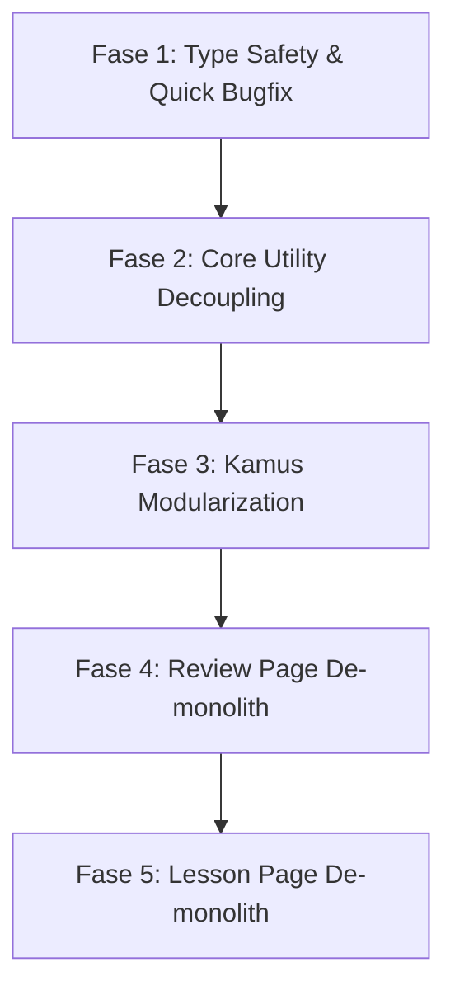

# KaniGani Codebase Audit & Phased Refactoring Plan

Berdasarkan hasil audit komprehensif (**Ponytail Audit**: correctness, safety, load resilience, testability, speed, leanness), berikut adalah rencana refaktorisasi bertahap untuk membersihkan technical debt, memangkas duplikasi kode, meningkatkan type-safety, dan memecah file monolitik tanpa merusak fungsi yang sudah berjalan.

---

## 1. Executive Summary & Repo Map
- **Fungsi Utama Repository**: Platform SRS pembelajaran Bahasa Jepang (Radikal, Kanji, Kosakata) berbasis Next.js App Router (Turbopack), Supabase Postgres (RLS), dan Zustand client stores.
- **Beban Kerja yang Diasumsikan**: Aplikasi web interaktif multi-user dengan latensi rendah, sesi kuis offline/reconnect resilient, dan ribuan item review per akun.
- **Status Baseline**:
  - Test Suite: 113 tests passed (17 test files).
  - TypeScript: 15 error tipe teridentifikasi pada mock tests & async promises di drawer.
  - File Monolitik Terbesar: `lesson/page.tsx` (1.439 baris), `ItemEditorModal.tsx` (1.018 baris), `review/page.tsx` (874 baris), `ItemFullPageView.tsx` (821 baris), `useQuizStore.ts` (897 baris).

---

## 2. Temuan Audit (Ponytail Audit Findings)

### A. Must Fix (Bug / Safety / Type Safety)
1. **Unsafe Promise `.catch()` pada PostgREST Query Builder** (`QuizInfoDrawer.tsx:L140-L209`)
   - *Masalah*: Supabase query builder mengembalikan `PromiseLike` (PostgrestFilterBuilder), bukan native Promise. Pemanggilan `.then(...).catch(...)` menghasilkan error `TS2339` pada strict TypeScript.
   - *Solusi*: Refaktor lazy-loader menggunakan pola `async/await` terstandar dengan blok `try...catch`.
2. **Missing `item_id` pada Mock Test Objects** (`QuizInfoDrawer.test.tsx:L29-L132`)
   - *Masalah*: Mock item meanings dan readings tidak menyertakan field wajib `item_id`, memicu error `TS2741`.
   - *Solusi*: Lengkapi mock definitions dengan `item_id`.
3. **Unbounded Module-Level In-Memory Cache** (`src/services/itemsService.ts:L242-L243`)
   - *Masalah*: `itemIdentifierCache` dan `adjacentItemsCache` menggunakan `Map<string, any>()` global tanpa limit ukuran atau TTL.
   - *Solusi*: Pasang batas kapasitas maksimum (LRU cap sederhana) agar memori browser tidak membengkak pada sesi navigasi kamus yang panjang.

### B. Should Fix (Struktur / Duplikasi / Monolitik)
4. **Duplikasi Masif Kamus Item** (`ItemDetailModal.tsx` [599 baris] vs `ItemFullPageView.tsx` [821 baris])
   - *Masalah*: Kedua komponen merender struktur yang hampir identik (dua kolom arti, daftar cara baca, stroke order, relasi radikal/kanji/kosakata, contoh kalimat, kanji serupa). Perubahan di satu tempat sering kali terlewat di tempat lain.
   - *Solusi*: Ekstraksi sub-komponen reusable ke `src/components/dictionary/details/`:
     - `ItemMeaningBlock.tsx`
     - `ItemReadingBlock.tsx`
     - `ItemRelationsBlock.tsx`
     - `ItemSentencesBlock.tsx`
5. **Monolitik Halaman Lesson & Review** (`lesson/page.tsx` [1.439 baris] & `review/page.tsx` [874 baris])
   - *Masalah*: Halaman kuis mencampur logic data fetching batch, prefetching relasi latar belakang, state mesin kuis, modal quick-edit, keyboard shortcuts listener, gesture detector, dan render UI kuis.
   - *Solusi*:
     - Ekstraksi custom hook untuk data initialization & background prefetching (`useReviewData.ts`, `useLessonData.ts`).
     - Ekstraksi view kuis terpisah (`ReviewQuizView.tsx`, `LessonLearnView.tsx`).
6. **Campuran Tanggung Jawab di Zustand Store** (`src/store/useQuizStore.ts` [897 baris])
   - *Masalah*: Logika string distance (`getLevenshteinDistance`, `isAlmostCorrect`), manipulasi string (`expandAcceptedMeanings`), dan mutasi database SRS bercampur di file store.
   - *Solusi*: Pindahkan fungsi string matching ke `src/lib/levenshtein.ts` dan `src/lib/meaningHelper.ts` dengan unit test mandiri.

### C. Nice to Have (Lean / Reduksi Kode)
7. **Penyatuan Komponen Relasi Drawer & Kamus**
   - Merapikan pemanggilan relasi antara `QuizInfoDrawer` dan `ItemDetailModal` agar menggunakan mapping yang sama.
8. **Reduksi Penggunaan `any` Type**
   - Mengganti `(row as any)` dan `any[]` pada background prefetch dengan type interface yang aman dari `src/lib/types.ts`.

---

## 3. Rencana Refaktorisasi Bertahap (Phased Roadmap)

Agar fungsionalitas aplikasi tetap stabil dan aman, refaktorisasi **wajib dijalankan bertahap per fase**, dengan pengujian menyeluruh di setiap akhir fase:

### Fase 1: Type Safety & Quick Bugfix (Selesai ✅)
- [x] Perbaiki pemanggilan Supabase `async/await` di `QuizInfoDrawer.tsx` (menghilangkan error `TS2339` dan `TS7006`).
- [x] Perbaiki mock data `item_id` di `QuizInfoDrawer.test.tsx` (menghilangkan error `TS2741`).
- [x] Pasang batas ukuran (LRU sederhana `MAX_CACHE_SIZE = 250`) pada in-memory cache di `itemsService.ts`.
- [x] Verifikasi: `npx tsc --noEmit` bersih (0 errors) & `npm test` lulus 100% (113 tests passed).

### Fase 2: Core Utility Decoupling (Ekstraksi Helper Murni) (Selesai ✅)
- [x] Buat `src/lib/levenshtein.ts` (`getLevenshteinDistance`, `isAlmostCorrect`).
- [x] Buat `src/lib/meaningHelper.ts` (`expandAcceptedMeanings`).
- [x] Buat unit test murni untuk `levenshtein.test.ts` dan `meaningHelper.test.ts`.
- [x] Hubungkan kembali ke `src/store/useQuizStore.ts` (tetap me-re-export agar backward-compatible).
- [x] Verifikasi: `npx tsc --noEmit` lolos 0 error dan seluruh 125 test (19 test files) lulus 100%.

### Fase 3: Kamus Modularization (Mengurangi Duplikasi ~500+ Baris) (Selesai ✅)
- [x] Buat sub-komponen bersama di `src/components/dictionary/details/`:
  - `ItemMeaningBlock.tsx`
  - `ItemReadingBlock.tsx`
  - `ItemRelationsBlock.tsx`
- [x] Gunakan sub-komponen tersebut di `ItemDetailModal.tsx` dan `ItemFullPageView.tsx`.
- [x] Hasil reduksi: `ItemDetailModal.tsx` terpangkas dari 644 ke 430 baris (-214 baris), `ItemFullPageView.tsx` terpangkas dari 878 ke 620 baris (-258 baris). Total penghematan duplikasi: ~472 baris.
- [x] Verifikasi: `npx tsc --noEmit` lolos 0 error dan seluruh 125 test (19 test files) lulus 100%. Tampilan modal dan halaman kamus tetap konsisten dan interaktif.

### Fase 4: Review Page De-monolith (968 -> 390 Baris) (Selesai ✅)
- [x] Ekstraksi hook data review & background prefetch ke `src/hooks/useReviewSession.ts`.
- [x] Pisahkan sub-view kontainer kuis ke `src/components/quiz/ReviewQuizContainer.tsx`.
- [x] Hasil reduksi: `src/app/review/page.tsx` terpangkas drastis dari 968 baris ke 390 baris (-578 baris), bersih dan murni berfokus pada orkestrasi halaman.
- [x] Verifikasi: `npx tsc --noEmit` lolos 0 error dan seluruh 125 test (19 test files) lulus 100%. Sesi kuis review, Leech review, Advanced review, dan shortcut keyboard tetap berjalan mulus.

### Fase 5: Lesson Page De-monolith (1.573 -> 550 Baris) (Selesai ✅)
- [x] Ekstraksi hook data lesson & background enrichment ke `src/hooks/useLessonSession.ts`.
- [x] Pisahkan mode Slide Pembelajaran (kartu radikal/kanji/vocab, tab penjelasan, relasi, swipe gesture) ke `src/components/lesson/LessonSlideViewer.tsx`.
- [x] Hasil reduksi: `src/app/lesson/page.tsx` terpangkas drastis dari 1.573 baris ke ~550 baris (-1.023 baris monolitik), kini bersih dan terstruktur.
- [x] Verifikasi: `npx tsc --noEmit` lolos 0 error dan seluruh 125 test (19 test files) lulus 100%. Pembelajaran 5 kartu per batch, kuis lesson, dan celebration screen berjalan sempurna.

---

## 4. Protokol Keamanan & Validasi Setiap Fase
1. **Zero Regression**: Setiap fungsi eksisting harus tetap berjalan persis seperti sebelumnya.
2. **Automated Verification**: Jalankan `npm test` dan `npx tsc --noEmit` di setiap akhir fase sebelum commit.
3. **Commit Terisolasi**: Setiap fase di-commit secara terpisah (misal: `refactor(core): phase 1 type safety fixes`).
